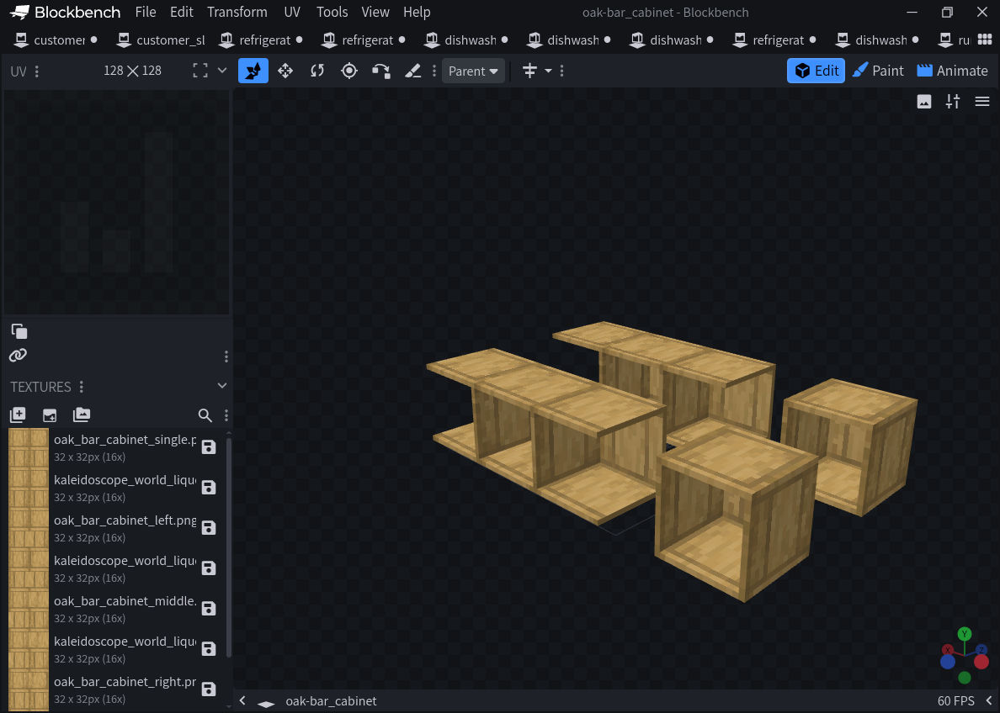
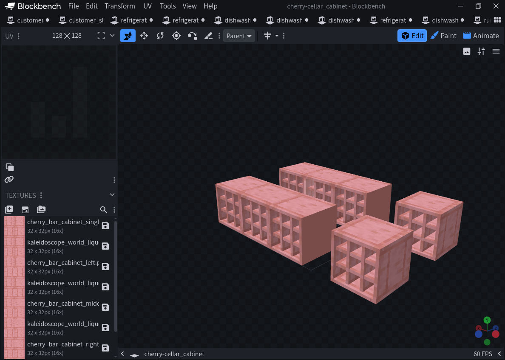
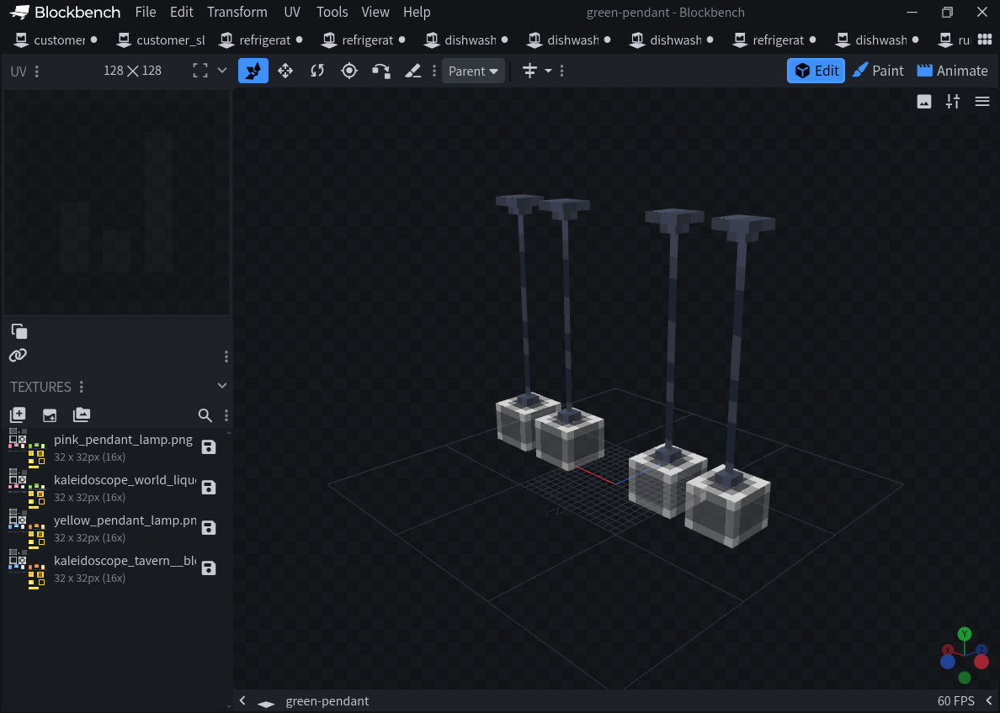
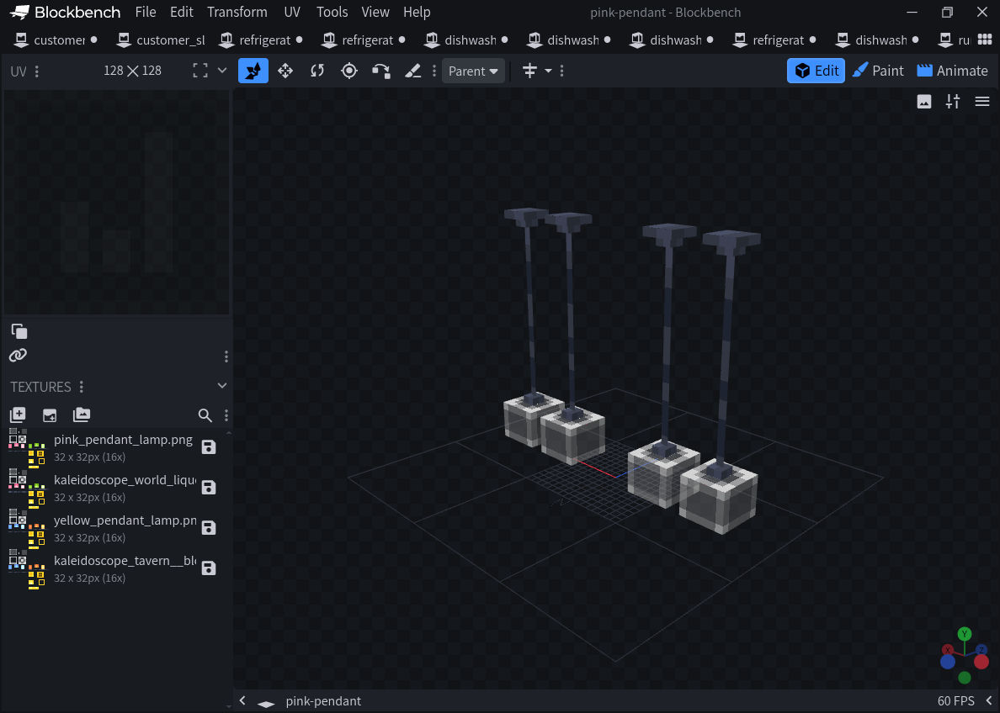

# Cabinet and pendant editor review, 2026-11-08

**Result:** no new geometry or UV defect was found in the reviewed views. This is actual Blockbench desktop evidence, not Minecraft client acceptance. No runtime, pack version, dependency, saved world or LIVE files changed.

## Scope and source

- Reviewed canonical commit `e66a4540e04e29f68f3673ebb9c59b53e8868543`, World Liquor 0.1.201 / Tavern dependency 0.6.205.
- Five woods (oak, birch, spruce, dark oak and cherry), two cabinet families, four states (single / left / middle / right): **40 block material/geometry bindings**, using eight shared geometry shapes.
- Green and pink pendant fixtures: source bottom plus the shared Tavern top, assembled at adjacent block heights. Each authored fixture contains two hanging lamps; each screenshot shows one source fixture and one canonical fixture, so four pendants are visible.
- Current-author selected fixtures are identified by `data/current-author-assets.json`, CurseForge file **9217896**, archive SHA-256 `d963089ad0a7f99a8950171d76913cfeea99a0126ee12b16c72c3162f8545da3`. Every selected-source hash was checked. Inherited model fixtures and all reviewed canonical inputs are individually hashed in [input-manifest.json](input-manifest.json).
- This session did not freshly extract the full 1.1.12 archive: the official download returned HTTP 403. The comparison uses the checked-in selected fixtures and their pinned provenance, not a claim that all upstream rendering code was rechecked.

## Method

The 12 self-contained projects in [review-scenes.zip](review-scenes.zip) are the exact files opened in the official Blockbench **5.2.2 Linux desktop**. Textures are embedded; unzip and open a `.bbmodel` through File → Open Model. Do not export these review composites into runtime.

Java models resolve their parent chains. UV coordinates are scaled per axis by the actual texture width/16 and height/16. Canonical Bedrock cubes use Blockbench's coordinate decode: invert X bounds and pivots, negate X/Y rotation, and reverse up/down UV endpoints. Source and canonical original PNG pixels are retained separately.

Cabinet scenes place Java at Z = -16 and canonical at Z = +16. Each row has a separated single cabinet at X = -40 and adjoining left/middle/right states at X = -12, 4 and 20. The source row appears lower-left and the canonical row upper-right in the captured isometric view. Pendant scenes place Java at X = -12 and canonical at X = +12, with the shared top at Y +16. Outliner group names identify the side independently of camera angle.

A static cross-check of the exact opened composites found **44/44 model pairs equal**: 40 cabinets plus four lamp halves, with the shared top counted twice. It compares zero-rotation cube bounds, face presence, per-face UV and rotation (normalizing equivalent 180° UV endpoint reversal), and decoded RGBA texture pixels. Zero-angle pivot values are immaterial and excluded. See [static-comparison.json](static-comparison.json). This supports the screenshots; it does not replace them or validate engine rendering.

## Observed results

- The five wood palettes and grain orientation match between the two sides.
- The single cabinet and connected run preserve end panels, shelf thickness, compartment layout and top/bottom seams in the inspected view.
- The two cabinet families remain distinct: open bar shelves versus subdivided cellar cubbies.
- Pendant suspensions meet the top/bottom boundary without a visible displaced segment. Both source and canonical show matching outer-shell shape and UV in the editor.
- No runtime repair was warranted from these observations.

### Cabinet screenshots

| Wood | Bar cabinet, four states | Cellar cabinet, four states |
|---|---|---|
| Oak | [Full screenshot](oak-bar_cabinet.jpg) | [Full screenshot](oak-cellar_cabinet.jpg) |
| Birch | [Full screenshot](birch-bar_cabinet.jpg) | [Full screenshot](birch-cellar_cabinet.jpg) |
| Spruce | [Full screenshot](spruce-bar_cabinet.jpg) | [Full screenshot](spruce-cellar_cabinet.jpg) |
| Dark oak | [Full screenshot](dark_oak-bar_cabinet.jpg) | [Full screenshot](dark_oak-cellar_cabinet.jpg) |
| Cherry | [Full screenshot](cherry-bar_cabinet.jpg) | [Full screenshot](cherry-cellar_cabinet.jpg) |

### Pendant screenshots

[Green fixture](green-pendant.jpg) · [Pink fixture](pink-pendant.jpg)

## Boundaries and checks

These are static isometric model views, not every possible viewpoint. The free-model review format does **not** reproduce Java `shade: false`, `cullface`, translucent/emissive lighting, Minecraft material sorting or shader behavior. In particular, the predominantly grey outer-shell preview is not evidence of in-game green/pink light or tint parity. Cabinet item contents, gameplay connection updates, first/third-person item display and storage behavior were not exercised here.

The existing `current_author_art.verify_source()` check passed. Existing `tools/test_java_face_topology.py` passed six tests; its historical stool/record checks are not evidence for these current cabinet shapes. The unchanged release baseline is checked separately in CI. No Minecraft client or local user computer was used, and no BDS result is represented as a visual pass.

[receipt.json](receipt.json) records the exact screenshot/project hashes and limitations. All 12 screenshots are unedited native-application captures, 1188 × 848 pixels. The earlier [freezer editor review](../freezer-editor-20261108/README.md) is a separate batch with its own source-version limits.
